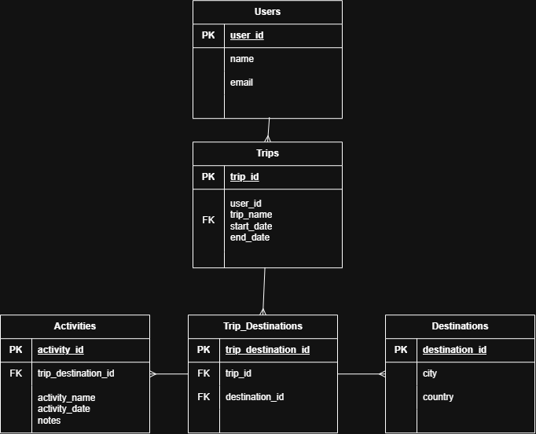

# Travel Planner Database

## About the Project

For this work requirement, I created a PostgreSQL database for a travel planner.

The idea is to have a database where users can create trips, add different destinations to their trips, and plan activities for each destination.

The database has five tables: `users`, `trips`, `destinations`, `trip_destinations`, and `activities`.

## Database Design

### Users

The `users` table stores information about the users, such as their name and email. Each user has their own `user_id` as the primary key.

### Trips

The `trips` table stores the trips created by users. One user can have several trips, so `user_id` is used as a foreign key to connect a trip to a user.

I also added `start_date` and `end_date` to store when the trip starts and ends.

### Destinations

The `destinations` table stores the city and country for each destination.

### Trip Destinations

I created the `trip_destinations` table to connect trips and destinations.

A trip can have several destinations, but the same destination can also be part of several different trips. This means there is a many-to-many relationship between `trips` and `destinations`.

The `trip_destinations` table is used as the intermediate table to solve this relationship.

### Activities

The `activities` table stores activities that are planned for a destination during a trip. It includes the activity name, date, and optional notes.

Each activity is connected to `trip_destinations` using `trip_destination_id` as a foreign key.

## Relationships

The main relationships in the database are:

- One user can have many trips.
- One trip can have many trip destinations.
- One destination can be connected to many trip destinations.
- One trip destination can have many activities.
- Trips and destinations have a many-to-many relationship through `trip_destinations`.

## Design Decisions

I used automatically generated integer IDs as primary keys for the tables because each record needs a unique identifier.

Foreign keys are used to connect the related tables. I used `NOT NULL` for information that is required and `UNIQUE` for the user email.

For trips, I also added a check constraint so the end date cannot be before the start date.

For `trip_destinations`, I added a unique constraint for `trip_id` and `destination_id`. This prevents the same destination from being added to the same trip more than once.

## ER Model

The ER diagram below shows the tables and their relationships.

## SQL Script

The SQL script is available in `travel_planner.sql`. It contains the DDL statements used to create the tables, primary keys, foreign keys, and constraints.