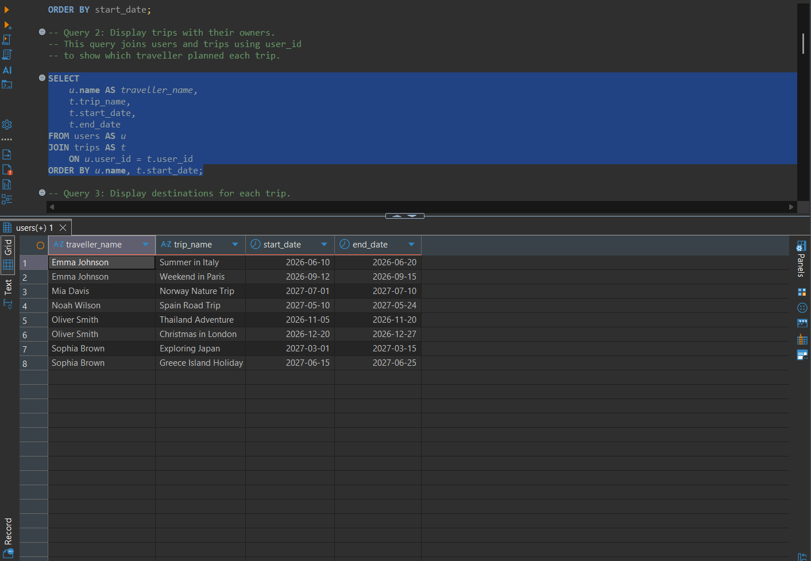
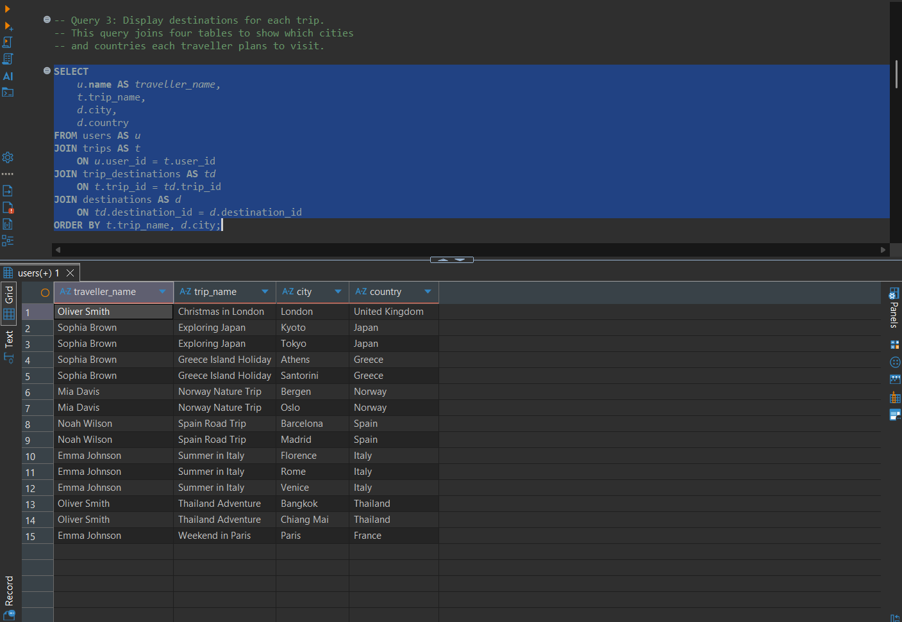
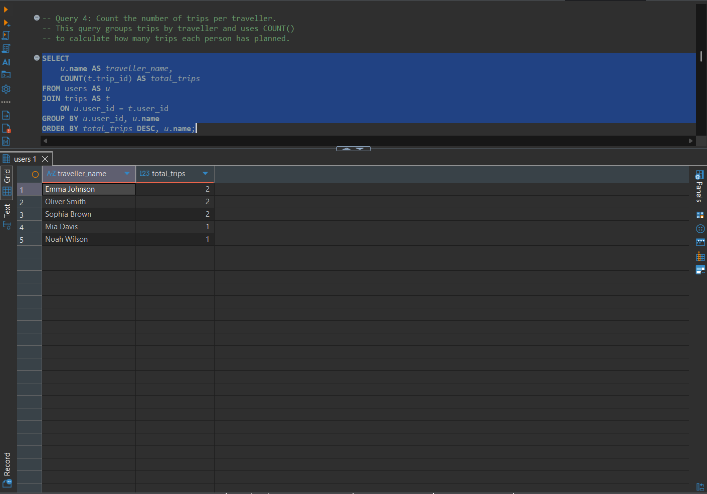
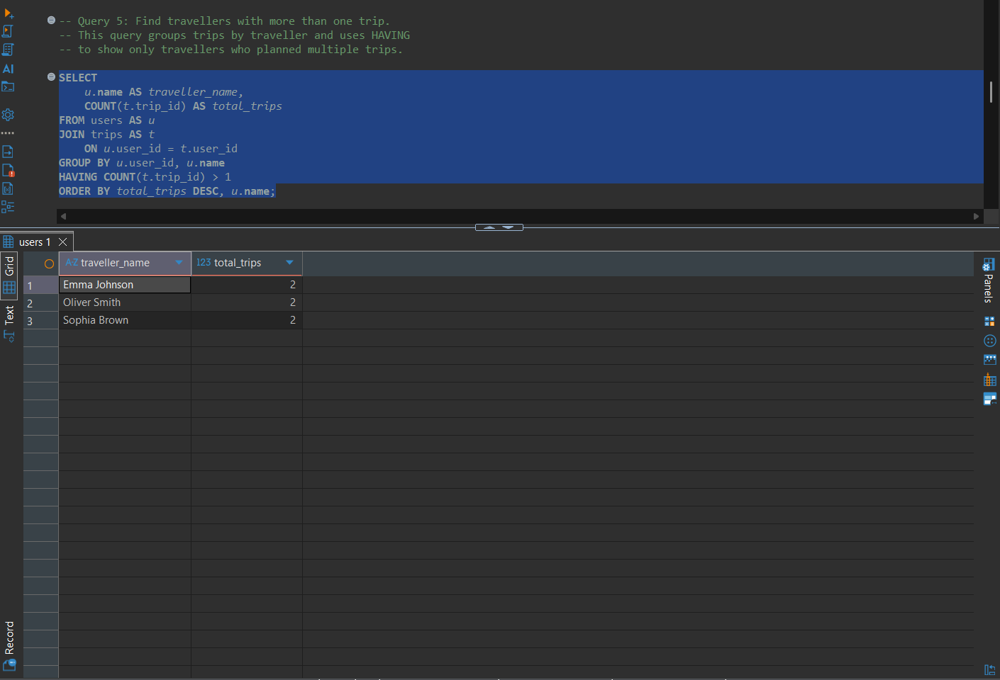
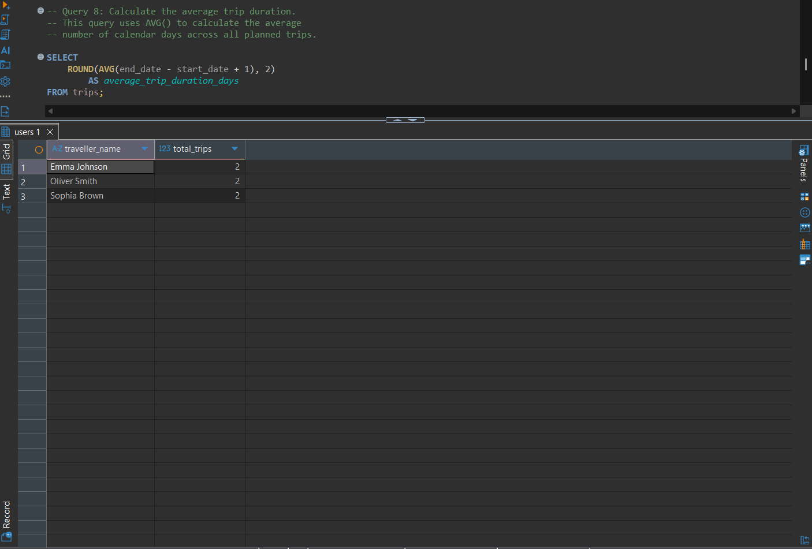
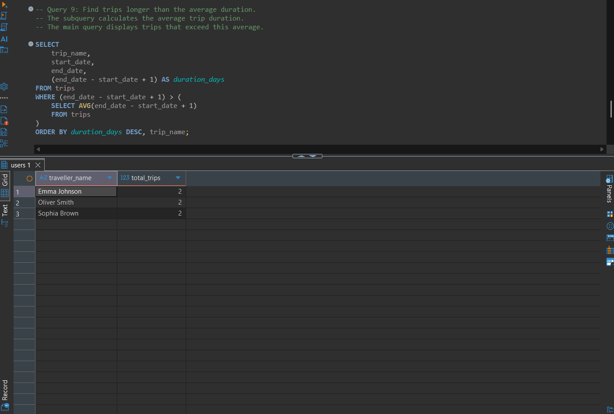

# PRO2003 Work Requirement 2: Travel Planner Database

## About the Project

For this work requirement, I continued working on the Travel Planner database that I created in Work Requirement 1.

The database is made for organising trips, destinations and activities. In this assignment, I focused on adding test data, updating and deleting records, and writing SQL queries to retrieve and analyse information.

I used PostgreSQL and DBeaver to work with the database and test my SQL queries.

## Tools Used

- PostgreSQL
- DBeaver
- SQL
- Visual Studio Code
- GitHub

## Database Structure

I reused the five tables from Work Requirement 1:

| Table | Description |
|---|---|
| users | Stores user names and emails |
| trips | Stores trips created by users |
| destinations | Stores cities and countries |
| trip_destinations | Connects trips with destinations |
| activities | Stores activities planned for each destination |

The tables are connected using primary keys and foreign keys.

## Adding and Modifying Data

I started by adding sample data to all five tables using `INSERT INTO`.

I added 5 users, 8 trips, 15 destinations, 15 trip destinations and 15 activities.

I then used `UPDATE` to change the notes for the Colosseum activity and `DELETE FROM` to remove the Santorini Sunset Tour activity.

After deleting the activity, there were 14 activities left in the database.

## SQL Queries

I created 10 SELECT queries to practise retrieving and analysing data.

| Query | What it does |
|---|---|
| 1 | Finds trips starting in 2027 |
| 2 | Shows which user planned each trip |
| 3 | Shows the destinations for each trip |
| 4 | Counts how many trips each user has |
| 5 | Finds users who have more than one trip |
| 6 | Counts the destinations in each trip |
| 7 | Calculates how many days each trip lasts |
| 8 | Finds the average trip duration |
| 9 | Finds trips that are longer than the average |
| 10 | Shows activities with their trips and destinations |

I used different SQL techniques, including `JOIN`, `COUNT`, `AVG`, `GROUP BY`, `HAVING` and a subquery.

## Query Results

Here are some screenshots of the queries I tested in DBeaver.

### Query 2: Trips and Users

I used JOIN to combine the users and trips tables so I could see who planned each trip.

### Query 3: Trips and Destinations

This query combines four tables to show the user, trip name, city and country.

### Query 4: Number of Trips per User

I used COUNT and GROUP BY to find out how many trips each user has planned.

### Query 5: Users with Multiple Trips

I used HAVING to show only the users who have planned more than one trip.

### Query 8: Average Trip Duration

I used AVG to calculate the average trip duration, which was 11.25 days.

### Query 9: Trips Longer Than Average

I used a subquery to compare each trip's duration with the average duration.

## Project Files

- `00_create_tables.sql` contains the database structure from Work Requirement 1.
- `01_insert_data.sql` contains the INSERT statements.
- `02_update_delete.sql` contains the UPDATE and DELETE statements.
- `03_select_queries.sql` contains the 10 SELECT queries.

## How to Run the Project

1. Create a new PostgreSQL database in DBeaver.
2. Run `00_create_tables.sql` to create the tables.
3. Run `01_insert_data.sql` to add the test data.
4. Run `02_update_delete.sql` to update and delete records.
5. Run `03_select_queries.sql` to see the query results.

The scripts should be run in this order on an empty database.

## Testing

I tested the SQL scripts in DBeaver using my original Travel Planner database.

I also created a separate database called `travel_planner_test` to check that everything worked from the beginning.

I was able to create all five tables, insert the test data, update and delete records, and run all 10 SELECT queries without errors.

## Conclusion

Through this assignment, I got more practice using SQL to work with a relational database.

I learned how to insert, update and delete data, combine tables using JOIN, and use functions like COUNT and AVG to analyse information.

I also got a better understanding of how GROUP BY, HAVING and subqueries work.