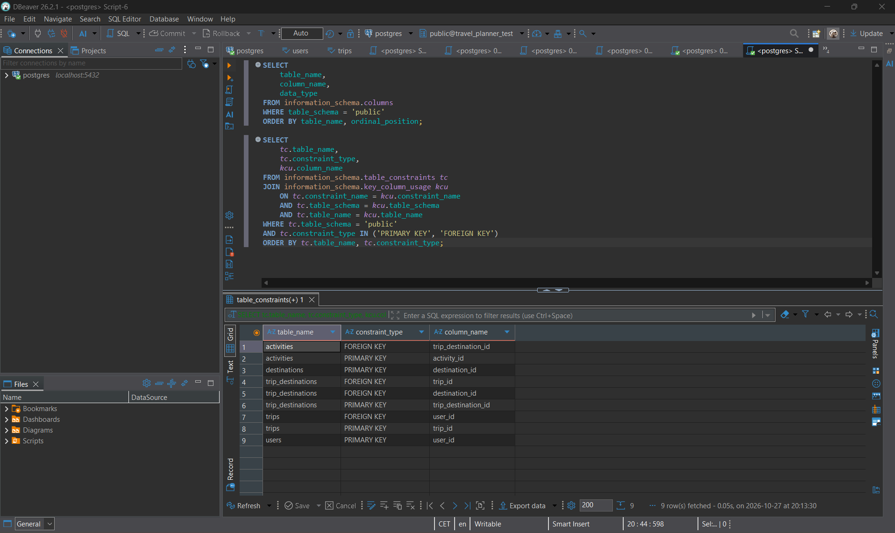
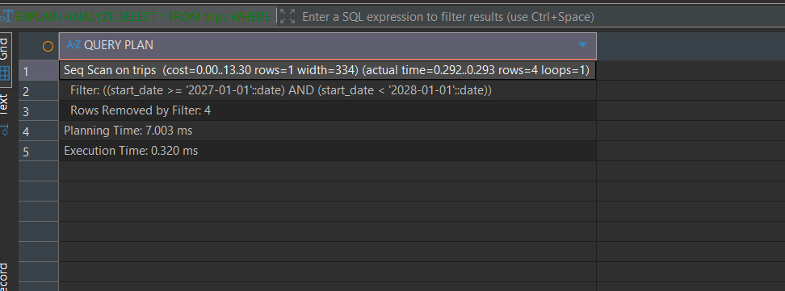
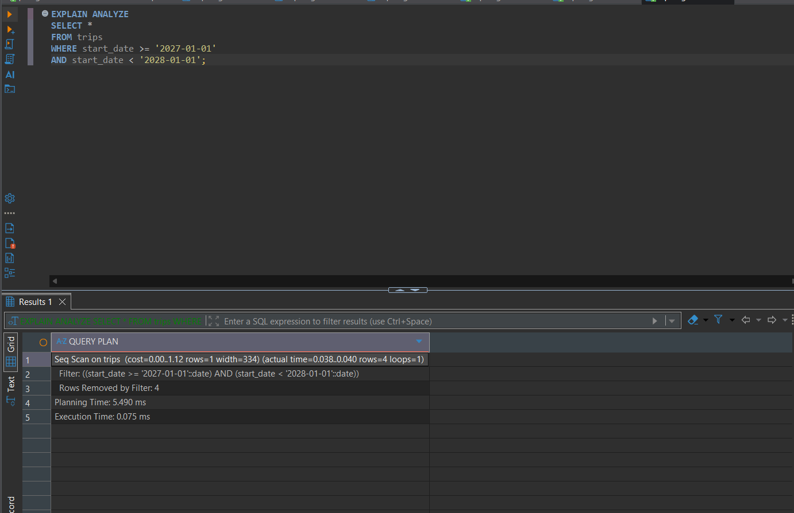
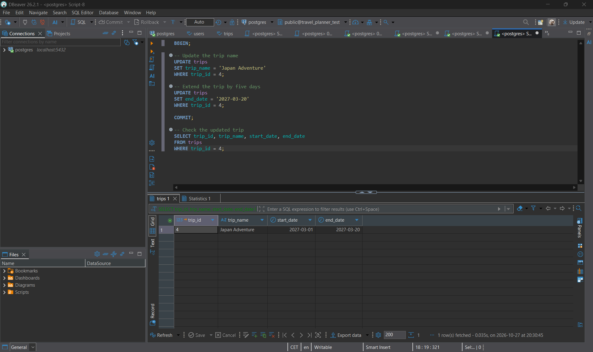

# Work Requirement 3: Improve and Protect Your PostgreSQL Database

## 1. Database Normalization (3NF)

I reviewed my Travel Planner database to see if it follows Third Normal Form (3NF).

My database has five tables: users, trips, destinations, trip_destinations and activities. Each table stores different information, and they are connected using primary keys and foreign keys.

For example, the trips table uses user_id to connect a trip to a user. The trip_destinations table connects trips and destinations, so I don't have to store the same destination information in several places.

This helps reduce duplicate data and keeps the database more organised.

Based on the table structure and relationships, I think my database follows 3NF because the information is separated into the correct tables, and I couldn't find any obvious problems that needed to be changed.

### Database Constraints

## 2. Index and Query Performance

I created an index on the start_date column in the trips table to see if it would improve the query performance.

Before creating the index, I used EXPLAIN ANALYZE to check how PostgreSQL searched for trips starting in 2027.

The first result showed a Sequential Scan, with an execution time of 0.320 ms.

After creating the index, I ran the same query again. The execution time was 0.075 ms, but PostgreSQL still used a Sequential Scan.

I think this is because my trips table only has eight rows, so PostgreSQL can search through the table quickly without using the index.

The execution time was lower in the second test, but I cannot say that the index caused the improvement because PostgreSQL did not use it.

### Before Adding the Index

### After Adding the Index

## 3. Transaction

I created a transaction to update two things in the trips table.

I used trip_id 4, which was originally called Exploring Japan. I changed the name to Japan Adventure and extended the end date from 15 March 2027 to 20 March 2027.

I used BEGIN to start the transaction and COMMIT to save both changes together. If something went wrong before committing, I could use ROLLBACK to undo the changes.

After running the transaction, I used SELECT to check if the changes were saved correctly. Both updates worked, and the trip now has the new name and end date.

### Transaction Result

